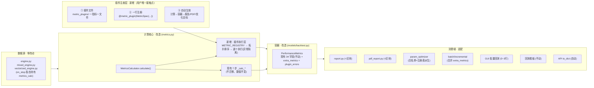
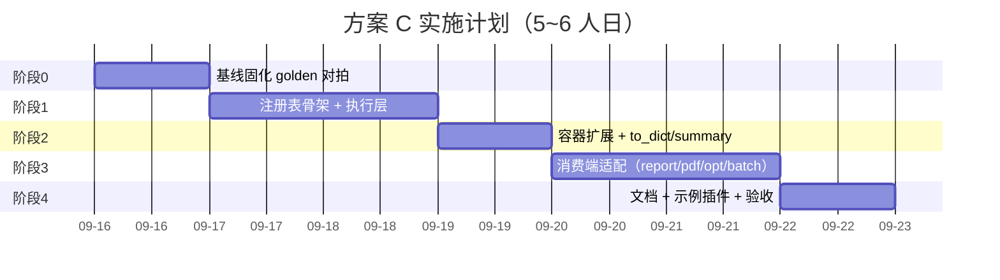

# 插件化注册表改造（方案 C）可行性报告

| 项目 | 内容 |
|---|---|
| 系统 | 鲲鹏量化交易系统（Pythonwdhmm） |
| 模块 | 回测指标（backtest metrics） |
| 方案 | C · 插件化注册表（架构改造） |
| 状态 | 评估完成，暂不动手 |
| 日期 | 2026-09-13 |

> 本报告所有文件引用、行号、函数名均为已核验的真实代码位置；结论基于代码事实，不含推测。

---

## 一、结论摘要

**结论：方案 C 可行，推荐实施，预计 5~6 人日，风险可控。**

支撑结论的三个关键事实：

1. **计算入口唯一** —— `MetricsCalculator.calculate()` 是全部指标的唯一计算入口，改造面集中在 `metrics.py` + `models/backtest.py` 两个文件，不需要碰撮合 / 记录器；
2. **容器天然可扩** —— `PerformanceMetrics` 是 dataclass，追加一个 `extra_metrics: Dict` 字段即可实现零破坏扩展，所有现有 34 个字段、`to_dict()` 中文键结构、`summary()` 输出全部不动；
3. **测试基线充分** —— `tests/unit/test_backtest.py::TestMetricsCalculator` 约 10 个用例 + `tests/unit/test_models.py::TestPerformanceMetrics` 的 to_dict 结构断言，可直接充当改造前后的“黄金对拍”基线。

**收益**：加一个指标的成本从「改 4 个文件」降到「1 个插件文件 + 1 行注册」，且插件自动进入报告、PDF、参数优化目标。

---

## 二、现状盘点（已核验事实）

### 2.1 数据流

```
三引擎 on_stop() ──► MetricsCalculator.calculate() ──► PerformanceMetrics ──► 6 个消费端
```

| 环节 | 文件:位置 | 现状 |
|---|---|---|
| 接线 | `engine.py:231/566`、`mixed_engine.py:269/1021`、`vectorized_engine.py:187/377` | 三引擎各自持有 `metrics_calc` 实例，调 `calculate()` 填 `result.metrics` |
| 计算 | `metrics.py::MetricsCalculator.calculate()` | 唯一入口，7 步 `_calc_*` 私有方法（收益/风险/风险调整/交易/成本/基准/分布），**无任何扩展点** |
| 容器 | `models/backtest.py::PerformanceMetrics` | dataclass 34 字段；`to_dict()` 中文分组；`summary()` 文本摘要；**无自定义字段通道** |
| 文本/HTML 报告 | `report.py::generate_text / _build_html` | 直接读字段 |
| PDF 报告 | `pdf_report.py::_render_metrics/_render_trade_stats` | 直接读字段 |
| 批量/增量排序 | `batch_backtest.py:177-179`、`incremental_backtest.py:131-133` | 只取 `total_return/sharpe_ratio/max_drawdown` 3 字段 |
| 参数优化 | `param_optimizer.py:55-59` | `OBJECTIVE_DIRECTION` 白名单 3 项，`__init__` 硬校验 `ValueError` |
| GUI 批量回测 | `gui/batch_backtest_tab.py:229-231` | 取 3 字段 |
| 回测看板 | `dashboard_serializer.py` | **刻意不注入 metrics**，前端 §CALC 现算 |
| API 序列化 | `BacktestResult.to_dict()` → `metrics.to_dict()` | 中文键嵌套结构 |

### 2.2 现状痛点（改造动机）

- **无扩展点**：加一个指标必须同时改 `metrics.py`（计算）、`models/backtest.py`（字段 + to_dict + summary）、`report.py`（展示），三处硬编码耦合；
- **参数优化白名单与计算层脱钩**：`OBJECTIVE_DIRECTION` 是手写常量，新增指标若想当优化目标，容易忘记注册导致 `ValueError`；
- **消费端字段漂移**：批量 / GUI 各维护一份“取 3 字段”的重复代码，指标多了之后同步成本线性上升；
- **三引擎无配置通道**：无法按引擎 / 场景开关某类指标。

---

## 三、目标架构设计

### 3.1 插件接口定义

```python
from dataclasses import dataclass, field
from typing import Any, Callable, Dict, Optional, Tuple

# ── 指标注册表 ──

@dataclass(frozen=True)
class MetricSpec:
    key: str                     # 指标唯一键，如 "return_drawdown_ratio"
    label: str                   # 中文标签，进 to_dict / 报告
    group: str = "自定义指标"      # 分组名
    objective_direction: Optional[bool] = None  # 供参数优化器派生白名单
    depends_on: Tuple[str, ...] = ()           # 依赖的其他指标 key（决定执行顺序）
    enabled: bool = True


class MetricRegistry:
    """指标插件注册表"""

    def __init__(self) -> None:
        self._plugins: Dict[str, Tuple[MetricSpec, Callable]] = {}

    def register(self, spec: MetricSpec, fn: Callable) -> None:
        if spec.key in self._plugins:
            raise ValueError(f"指标重复注册: {spec.key!r}")
        self._plugins[spec.key] = (spec, fn)

    def specs(self) -> Dict[str, MetricSpec]:
        return {k: v[0] for k, v in self._plugins.items()}

    def get(self, key: str) -> Optional[Callable]:
        item = self._plugins.get(key)
        return item[1] if item else None

    def keys(self):
        return list(self._plugins)


METRIC_REGISTRY = MetricRegistry()


def metric_plugin(spec: MetricSpec):
    """装饰器：注册指标插件"""
    def _wrap(fn: Callable) -> Callable:
        METRIC_REGISTRY.register(spec, fn)
        return fn
    return _wrap
```

**插件函数签名**（统一上下文，防未来函数约束不变）：

```python
@dataclass
class MetricContext:
    """插件执行上下文：与现有 7 步 _calc_* 的输入完全同源"""
    equity_df: Any          # 按日去重后的净值 DataFrame（含 equity/cash/position_value）
    returns: Any            # pct_change() 后的日收益 Series
    trades: list            # 成交记录（TradeRecord 列表）
    benchmark_df: Any       # 基准净值 DataFrame（可选，None 表示无基准）
    metrics: Any            # 已算好的既有指标（供依赖读取，防未来函数由引擎保证）


@metric_plugin(MetricSpec(
    key="return_drawdown_ratio",
    label="收益回撤比",
    objective_direction=True,
    depends_on=("annualized_return", "max_drawdown"),
))
def return_drawdown_ratio(ctx: MetricContext) -> float:
    """示例插件：年化收益 / 最大回撤（与 Calmar 区分口径）"""
    if ctx.metrics.max_drawdown > 0:
        return ctx.metrics.annualized_return / ctx.metrics.max_drawdown
    return 0.0
```

### 3.2 MetricsCalculator 改造

```python
def calculate(self, equity_curve, trades, benchmark_curve=None, start_date="", end_date=""):
    metrics = PerformanceMetrics()
    # ... 现有 7 步 _calc_* 保持不动（内置指标）...
    self._calc_distribution_metrics(metrics, returns)
    # 新增：执行注册插件（依赖拓扑排序，单插件异常隔离，不影响其他指标）
    self._run_registered_plugins(metrics, ctx)
    return metrics
```

要点：

- **内置 7 步不迁移**（阶段化：首批不搬，降低风险），只追加插件执行层 —— 这是“零数值漂移”的关键决策；
- 插件执行顺序按 `depends_on` 拓扑排序，同依赖的按注册序；
- 每个插件 `try/except` 隔离，失败记日志并写入 `metrics.plugin_errors`，不中断回测。

### 3.3 PerformanceMetrics 扩展

```python
@dataclass
class PerformanceMetrics:
    # ... 现有 34 字段全部保留 ...
    extra_metrics: Dict[str, Any] = field(default_factory=dict)   # 新增，默认空，零破坏
    plugin_errors: Dict[str, str] = field(default_factory=dict)   # 新增，插件失败记录
```

`to_dict()` 追加分组 `"自定义指标"`（仅当 `extra_metrics` 非空时出现），`summary()` 同理。**旧键一个不动** → `test_models.py` 的结构断言全部通过。

### 3.4 消费端适配策略

| 消费端 | 适配方式 | 改动量 |
|---|---|---|
| report.py / pdf_report.py | 遍历 `extra_metrics` 渲染“自定义指标”区块（有值才显示） | 各 ~10 行 |
| param_optimizer.py | `OBJECTIVE_DIRECTION` 改为从注册表派生：`{k: spec.objective_direction for k, spec in ... if spec.objective_direction is not None}` | 删常量、加派生函数 |
| batch / incremental | metrics 字典合并 `extra_metrics`（`{**three, **extra}`），**旧 3 键不动** | 各 ~3 行 |
| GUI batch_backtest_tab | 同上合并；或暂不改（3 键仍可用） | 0~3 行 |
| dashboard_serializer | **默认不动**（前端现算）；若插件指标要上板，走 `result.extra` 透传并配前端 | 文档化 |
| API / BacktestResult.to_dict | 自动生效（`metrics.to_dict()` 已含新分组） | 0 |

### 3.5 三引擎

**零改动**。`metrics_calc` 实例化处（3 处）可选支持 `enabled_plugins: Optional[List[str]]` 构造参数（None = 全部启用），不传则行为与现在完全一致。

### 3.6 目标架构图



---

## 四、可行性评估

### 4.1 技术可行性：高

- 唯一计算入口 + dataclass 可扩展 → 改造面收敛，无结构性障碍；
- 项目已有同类注册表先例可参照：`param_optimizer.py:62-64 STRATEGY_REGISTRY`（策略注册表）、`myquant/strategies/registry.py` —— 模式成熟；
- `pickle_checker.py` 已存在，插件多为模块级纯函数，天然可 pickle，兼容进程池（batch / param_optimizer 用 `ProcessPool`）。

### 4.2 影响面（改造触点清单）

| 文件 | 改动类型 | 风险 | 说明 |
|---|---|---|---|
| `metrics.py` | 新增注册表 + 执行层 + 插件示例 | 中 | 核心改造，用黄金对拍验证 |
| `models/backtest.py` | 新增 2 字段 + to_dict/summary 追加分组 | 低 | 纯增量 |
| `report.py` | 新增自定义指标区块 | 低 | 有值才渲染 |
| `pdf_report.py` | 同上 | 低 | 同上 |
| `param_optimizer.py` | 白名单改为派生 | 中 | 注意派生后白名单内容须与现在完全一致 |
| `batch_backtest.py` / `incremental_backtest.py` | 合并 extra | 低 | 旧 3 键不动 |
| `gui/batch_backtest_tab.py` | 可选 | 低 | 可后置 |
| `dashboard_serializer.py` | 不动（文档化） | — | 设计使然 |
| 新增 `myquant/backtest/metric_plugins/` 包 | 新文件 | 低 | 内置示例插件 + 用户插件落点 |

### 4.3 风险与缓解

| # | 风险 | 等级 | 缓解措施 |
|---|---|---|---|
| R1 | **数值漂移**：插件执行层引入后内置指标计算路径被改动 | 高 | 内置 7 步**不迁移**；阶段 0 先固化 golden 基线，改造后对拍全等 |
| R2 | to_dict 结构变更破坏 API / 测试 | 中 | 只追加新分组、旧键不动；`test_models.py` 全量跑通为准 |
| R3 | 参数优化白名单派生后内容漂移 | 中 | 派生结果与现有 `OBJECTIVE_DIRECTION` 逐项断言相等 |
| R4 | 插件依赖顺序错误（如 Calmar 依赖 max_drawdown） | 中 | `depends_on` 声明 + 拓扑排序；缺依赖时插件直接跳过并记 `plugin_errors` |
| R5 | 多进程下插件不可 pickle | 低 | 强制模块级函数（`pickle_checker` 校验纳入 CI） |
| R6 | 看板前端不同步导致用户误以为指标缺失 | 低 | 报告 / 文档明确“看板指标由前端现算”；插件指标走 extra 透传为可选增强 |

### 4.4 兼容性结论

- **向后兼容**：`calculate()` 签名不变；`PerformanceMetrics` 字段不变；三引擎零改动；6 个消费端即使一个不改也能以旧行为运行；
- **默认行为等价**：未注册任何自定义插件时，输出与改造前逐字节一致；
- **不破坏既有测试**：现有测试全部保持绿色为硬验收线。

---

## 五、实施计划（阶段化）

| 阶段 | 内容 | 验收 | 工作量 |
|---|---|---|---|
| 0 | 基线固化：跑现有回测，导出 golden 指标 JSON（三引擎 × 多标的） | golden 文件落盘、可复现 | 0.5 人日 |
| 1 | 注册表骨架：`MetricSpec` + 装饰器 + `METRIC_REGISTRY` + 拓扑排序执行层 | 内置指标经插件层跑通且与 golden 全等 | 1.5~2 人日 |
| 2 | 容器扩展：`extra_metrics` + `to_dict/summary` 新分组 | `test_models.py` 绿 + 手工验证新分组 | 0.5~1 人日 |
| 3 | 消费端适配：report / pdf / optimizer 派生白名单 / batch 合并 | 每处有对应单测；白名单逐项相等断言 | 1~1.5 人日 |
| 4 | 文档 + 示例插件（收益回撤比、月度胜率等 2~3 个）+ 验收 | 新插件“1 文件 + 1 装饰器”全链路生效 | 1 人日 |
| **合计** | | | **5~6 人日** |

### 实施时间线



---

## 六、验收标准（可测）

1. **数值等价**：默认配置（无自定义插件）下，三引擎回测指标与改造前 golden 数据完全一致（`assert` 全等或浮点容差内）；
2. **零破坏**：`tests/unit/` 全部现有测试通过，`TestPerformanceMetrics` to_dict 结构断言不变；
3. **插件全链路**：新增示例插件后，指标同时出现在 `result.metrics.to_dict()`、HTML/PDF 报告、参数优化目标下拉，全程**不修改** `metrics.py` / `models/backtest.py` / 三引擎；
4. **依赖与隔离**：构造一个 `depends_on` 缺失的插件 → 被跳过且 `plugin_errors` 记录，其余指标不受影响；
5. **并发安全**：`pickle_checker` 校验所有插件，批量回测 / 参数优化进程池正常跑通。

---

## 七、决策建议

| 选项 | 适用 | 成本 | 效果 |
|---|---|---|---|
| **方案 C 完整实施** | 指标会持续增加、多人 / 多策略共用 | 5~6 人日 | 加指标成本降至 1 文件 + 1 行，长期最优 |
| 方案 C 裁剪版（阶段 0~2 先行） | 先验证可行性再铺开 | 2.5~3.5 人日 | 拿到“注册表 + 零漂移”核心能力，消费端后置 |
| 维持方案 B（直接改代码） | 指标 1~2 个、低频 | 0.5~1 人日 | 最快，但下次加指标仍要改核心 |

**建议**：若为长期维护的核心系统，方案 C 的投入产出比明显优于反复的方案 B —— 每加一个指标都在重复支付“改 4 个文件”的成本。但**务必先做阶段 0**：没有 golden 基线，任何架构改造都有悄悄改变指标数值的风险。

---

## 附录 A：本次审查涉及的代码位置速查

| 用途 | 位置 |
|---|---|
| 指标计算器（唯一入口） | `myquant/backtest/metrics.py` |
| 指标容器（34 字段） | `myquant/models/backtest.py::PerformanceMetrics` |
| 回测结果容器 | `myquant/models/backtest.py::BacktestResult` |
| 三引擎接线 | `myquant/backtest/engine.py`、`mixed_engine.py`、`vectorized_engine.py` |
| 文本/HTML 报告 | `myquant/backtest/report.py` |
| PDF 报告 | `myquant/backtest/pdf_report.py` |
| 批量/增量回测 | `myquant/backtest/batch_backtest.py`、`incremental_backtest.py` |
| 参数优化 | `myquant/backtest/param_optimizer.py` |
| 看板序列化 | `myquant/backtest/dashboard_serializer.py` |
| GUI 批量回测 | `myquant/gui/batch_backtest_tab.py` |
| 指标测试 | `tests/unit/test_backtest.py::TestMetricsCalculator`、`tests/unit/test_models.py::TestPerformanceMetrics` |
| 策略注册表（先例参考） | `myquant/strategies/registry.py`、`param_optimizer.py::STRATEGY_REGISTRY` |

---

*报告完 · 鲲鹏量化交易系统 Pythonwdhmm · 2026-09-13*
