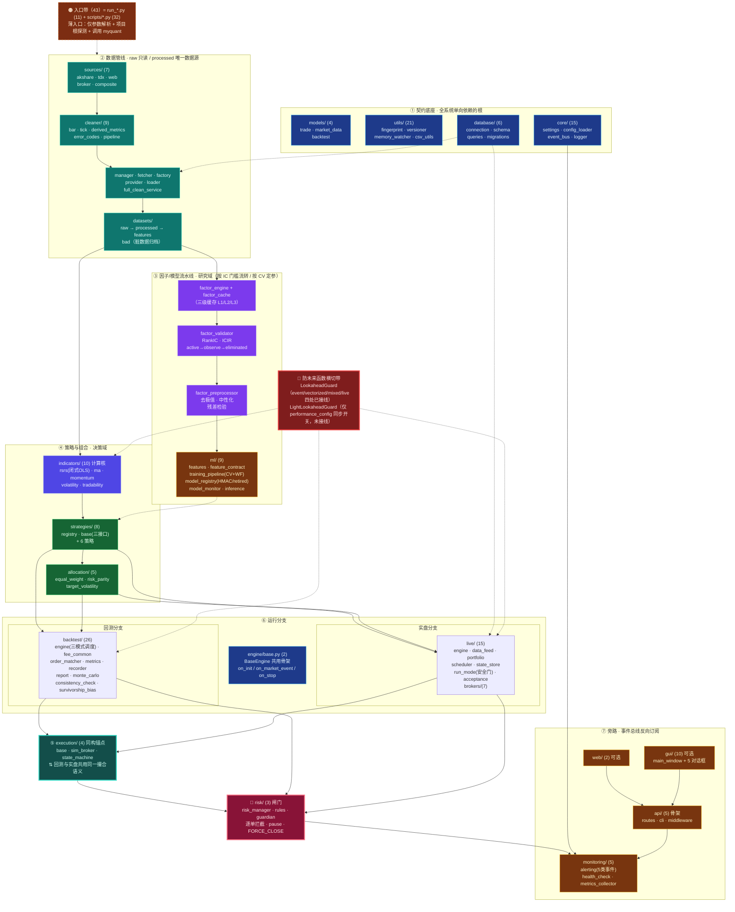

# 项目结构模块导图 v2.3 · 评审报告

> **评审对象**：`项目结构模块导图_v2.3.png`（Pythonwdhmm · 鲲鹏量化交易系统）
> **对拍基线**：`D:\Projects\Pythonwdhmm` 磁盘实测 + `docs/project_layout_gear2.md`（折中档位2蓝图）+ `docs/architecture.md` + `myquant/__init__.py` 自述包清单
> **评审角色**：量化系统架构评审（以"证伪"为默认立场，每条结论附证据）
> **评审日期**：2026-10-04
> **证据口径**：`myquant/**/*.py` 全量 Glob 实测（含 `__init__.py`、含 `migrations/`、含 `transports/`、含 `widgets/`）
> **事实优先级**：磁盘文件系统 = 物理事实 > `myquant/__init__.py` 自述 > 蓝图待验声明 > 导图标注

---

## 一、总体判定

### 判定：**方向对，切分粒度不对 —— 可作沟通图，不可作架构依据**

导图的**分层大方向与代码基线一致**（数据 → 因子 → 策略 → 回测/实盘 → 接口监控，单向依赖），这一点经三方对拍确认无误。

但存在三个结构性问题：

| 序号 | 问题 | 严重级 | 后果 |
|---|---|---|---|
| 1 | **切分维度不统一** | P1 | 无法判断"两个区块能否互相 import" |
| 2 | **包数与文件计数与磁盘不符** | P2 | 架构评审必在"到底多少文件"上失焦 |
| 3 | **量化系统三条命门被压缩成胶囊** | P0（认知层） | 防未来函数/回测实盘同构/执行共用全部不可见 |

**问题 1 详述**：导图混用了四种切分维度——

- 按**包**切：⑦回测引擎 = `backtest/`、⑥策略 = `strategies/`
- 按**层**切：②因子与机器学习、③核心链路
- 按**职责**切：④组合与风控（= `allocation/` + `risk/` 两个包）
- 按**非代码目录**切：⑤运维交付 = `scripts/`（这不是模块，是薄入口集合）

维度混用的直接危害：看导图的人无法回答"`monitoring` 能不能 import `backtest`"这类分层校验问题，而这正是 `docs/量化项目结构系统全面核查_规范提示词_v1.1.md` D5 维度（数据流与依赖边界·红线）的核心。

**问题 3 详述**：`myquant/__init__.py:27-31` 写明的"4 条铁律"中，铁律 2（回测/实盘共用代码）与铁律 4（严格禁用未来函数）在导图上只体现为 `core/` 区块里两个彩色小格（`lookahead_guard.py`、`light_lookahead_guard.py`），视觉权重低于 `cache.py`、`constants.py`。

---

## 二、导图 vs 磁盘：计数对拍

### 2.1 汇总行对拍

| 项目 | 导图声明 | 磁盘实测 | 偏差 | 判定 |
|---|---:|---:|---:|---|
| py 子包数 | 10 | **19** | -9 | ❌ 与 `myquant/__init__.py` 自述的 18 个也矛盾 |
| py 文件数 | 158 | **186** | -28 | ❌ 口径不明 |
| `run_*` 入口 | 12 | **11** | +1 | ⚠️ 计数虚高 |
| `scripts/` 入口 | 31 | **32** | -1 | ⚠️ 少 1 |

### 2.2 逐区块实测对拍

| 导图区块 | 对应包 | 导图标注 | 磁盘实际 | 判定 |
|---|---|---:|---:|---|
| ① 数据层 | `data_access/`（含 `sources/` `cleaner/`） | 35 | **37** | 少 2 |
| ① 数据层 | `datasets/` + `models/` 混入 | — | 4（`models`） | 边界不清 |
| ② 因子与ML | `indicators/` | ≈10 节点 | **10** | ✅ |
| ② 因子与ML | `ml/` | 2 节点 | **9** | ❌ 严重压缩 |
| ③ 核心链路 | `core/`（含 `transports/`） | ≈40 | **15** | — |
| ③ 核心链路 | `utils/` | — | **21** | — |
| ③ 核心链路 | `engine/` | — | **2** | 未单独体现 |
| ③ 核心链路 | `database/` | 混入 | **6** | 边界错位 |
| ④ 组合与风控 | `allocation/` + `risk/` | 7 | 8（5+3） | 少 1 |
| ⑥ 策略 | `strategies/` | 8 | **8** | ✅ |
| ⑦ 回测引擎 | `backtest/` | 27 | **26** | 计数虚高 |
| ⑧ 实盘执行 | `live/`（含 `brokers/`） | 17 | **15** | 多算 2 |
| ⑧ 实盘执行 | `execution/` 混入 | — | **4** | ❌ 未独立成块 |
| ⑨ 接口与监控 | `gui/`（含 `widgets/`） | 13 | **10** | 多算 3 |
| ⑨ 接口与监控 | `api/` | — | **5** | 少列 2 |
| ⑨ 接口与监控 | `web/` | — | **2** | — |
| ⑨ 接口与监控 | `monitoring/` | — | **5** | — |
| — | `monitoring`/`web`/`api`/`gui` 合计 | 13 | **22** | ❌ 少 9 |
| **合计** | | **10 包 / 158** | **19 包 / 186** | ❌ |

### 2.3 逐包精确清单（评审基线）

| 包 | 文件数 | 代表模块 |
|---|---:|---|
| `data_access/` | **37** | `sources/`(7) + `cleaner/`(9) + `manager/fetcher/factory/provider/loader` + 6 个 service |
| `utils/` | **21** | `data_fingerprint` `data_versioner` `memory_watcher` `cache_sync` `parallel` `cleanup_service` |
| `core/` | **15** | `settings` `config_loader` `lookahead_guard` `light_lookahead_guard` `event_bus` + `transports/`(4) |
| `live/` | **15** | `engine` `data_feed` `portfolio` `scheduler` `state_store` `run_mode` `acceptance` + `brokers/`(7) |
| `backtest/` | **26** | `engine` `vectorized_engine` `mixed_engine` `batch_backtest` `fee_common` `order_matcher` + 报告族 |
| `gui/` | **10** | `main_window` + 5 对话框 + `widgets/`(4) |
| `indicators/` | **10** | `rsrs` `moving_average` `momentum` `volatility` `tradability` + `factor_*`(4) |
| `ml/` | **9** | `features` `feature_contract` `training_pipeline` `model_registry` `model_monitor` `inference_service` |
| `strategies/` | **8** | `registry` `base` + 6 策略 |
| `risk/` | **3** | `risk_manager` `rules` `guardian` |
| `database/` | **6** | `connection` `schema` `queries` + `migrations/`(3) |
| `api/` | **5** | `routes` `cli` + `middleware/`(2) + `models/schemas` |
| `allocation/` | **5** | `base` + 等权/风险平价/目标波动率 |
| `models/` | **4** | `trade` `market_data` `backtest` |
| `execution/` | **4** | `base` `sim_broker` `state_machine` |
| `monitoring/` | **5** | `alerting` `health_check` `metrics_collector` `data_quality_explorer` |
| `web/` | **2** | `dashboard` |
| `engine/` | **2** | `base`（回测/实盘共用骨架） |
| **合计** | **186** | |

### 2.4 细节性错误

| 位置 | 导图 | 磁盘实际 | 类型 |
|---|---|---|---|
| ⑦回测引擎 | `fee_commom.py` | **`fee_common.py`** | 拼写错误 |
| ①数据层 | `final_service.py` | **`financial_service.py`** | 缺字 |
| 汇总行 | `10 子包` | 19 | 旧口径（疑为折中档位2蓝图起草时数字） |
| ⑤运维交付 | 8 个 `run_*.py` | 11 个（漏 3 个鲲鹏家族入口） | 漏列 |

漏列的 3 个根入口：`run_鲲鹏批量回测.py`、`run_鲲鹏参数优化.py`、`run_鲲鹏一键应用推荐参数.py`。

---

## 三、四件"不符合量化项目逻辑"的地方

### 3.1 ② 「因子与机器学习」把三个职责合并，切在了错误的接缝上

该区块实际混装了三种运行期特性完全不同的东西：

| 真实职责 | 文件 | 运行期特性 | 版本敏感度 |
|---|---|---|---|
| **计算核** | `indicators/{moving_average,momentum,volatility,rsrs,tradability}` + `factor_engine.py` + `factor_cache.py` | 高频、纯函数、有状态流式 `update()` | **极高**：回测/实盘必须逐位一致，任何改动即口径变更 |
| **有效性闸门** | `factor_validator.py`（RankIC/ICIR/分层/换手、`active→observe→eliminated` 状态流转） | 研究阶段、离线批处理 | 低：决定"因子能否进组合" |
| **统计处理** | `factor_preprocessor.py`（自适应去极值/中性化/残差检验） | 调仓截面批处理 | 中：决定"因子值长什么样" |

同时 `ml/` 是**完整 9 模块产线**，但导图只画了 2 个点：

```
features（含 IncrementalFeatureSession / TradeCost 成本化标签 / tradability 过滤）
  → feature_contract（特征签名契约：列集合+顺序硬校验、dtype 软校验）
  → training_pipeline（time_series_cv_split / run_cv / walk_forward 滚动扩展窗 CV）
  → model_registry（HMAC 签名、retired 失效态、win_gate 跑赢 active 才激活）
  → model_monitor（连续 N 月 |IC|<阈值 自动降级）
  → inference_service / inference_benchmark（P50/P95/P99 延迟基准）
```

**结论**：导图把 `ml/` 的视觉权重压到低于 `factor_cache.py`，会把研发优先级读反。正确切法是拆成两个域：

- **因子/模型流水线（研究域）**：按 IC 门槛流转、按 CV 定参、有版本与签名；
- **指标计算核（运行域）**：回测实盘共用、不可有版本漂移、改动即需一致性回归。

### 3.2 ④ 「组合与风控」把运行期耦合度极低的两个模块绑在一起

| 模块 | 触发时机 | 作用范围 | 失败后果 |
|---|---|---|---|
| `allocation/` | **调仓时点**（周期性） | 组合级资金分配 | 配置失衡，非即时风险 |
| `risk/` | **逐单**（每笔订单提交前） | 单笔/账户级 | 真金损失；可 `pause` 新开仓、可触发 `FORCE_CLOSE` |

二者在调用链上的位置完全不同。风控是 `live/engine._process_signal` 中这一段**同一锁域**内的最后一道闸（详见 `docs/project_layout_gear2.md` 回写#45 的 BUG-03 TOCTOU 修复）：

```
风控检查 → 数量计算 → 信号转订单 → lookahead 记录 → RiskManager 检查 → BUY 占位登记
```

绑在一块，导图就丢掉了"**闸门在哪**"这个对量化系统最关键的位置信息。建议把 `risk/` 单独成块，并标注"横切于回测与实盘的订单提交前"。

### 3.3 ⑧ 「实盘执行」把执行抽象层与实盘引擎混在了一起

导图将 `execution/`（`base.py` / `sim_broker.py` / `state_machine.py`）并入"实盘执行"块。后果：

- **回测与实盘共用同一套订单状态机/撮合语义**这条同构铁律在图上消失；
- 实际文件中，`execution/` 在回测侧被 `backtest/order_matcher.py` 复用、在实盘侧被 `live/brokers/`（`paper_broker`/`qmt_broker`/`ptrade_broker`）复用——它是**回测↔实盘的同构物理锚点**，必须独立成块。

### 3.4 ⑤ 「运维交付」把 32 个脚本入口当成一个模块区块

`scripts/` 不是模块，是**薄入口集合**。导图给它的体量（31 个文件）比 `core/`（15）还大，会产生两个误导：

1. 让人以为"改脚本 = 改系统能力"，而项目的架构纪律是"业务逻辑归 `myquant`、脚本只做薄入口"（见 `docs/代码变更治理规则.md`、审计规程 D6 薄入口纪律：有效业务语句 ≤30）；
2. 内部混装了三类完全不同的东西未拆分：

| 类别 | 脚本 | 服务对象 |
|---|---|---|
| 数据运维 | `数据下载` `数据清洗` `数据全量清洗` `数据导出_DB到processed` `复权因子同步` `同步交易日历` `同步股本变动` `财务CSV更新` `财务数据入库` `数据库迁移` `数据库初始化` `缓存管理` `垃圾数据清理` `清理历史回测输出` | 数据层 |
| 回测运维 | `标的预筛选` `参数优化` `增量回测` `一致性校验` `性能基准测试` `候选池交叉验证` `生成回测报告` `验收_回测引擎V5` `kunpeng_param_scan` `结果备份` `初始化项目目录` | 回测域 |
| 实盘运维 | `双券商模拟实盘` `实时行情驱动` `实盘模拟回测` `一键平仓` `仿真准入评估` `运行API` `推理延迟基准` | 实盘/接口域 |

**建议**：脚本应画成**挂载边**（细线挂在对应带上），不占节点体量。

---

## 四、五个关键缺失（量化逻辑上不能丢）

### 4.1 防未来函数横切带 ⚠️ 最高优先级

`core/lookahead_guard.py` + `light_lookahead_guard.py` 在导图上只是 `core/` 区块里的普通小格。实测接线状态：

| 校验器 | 消费方 | 状态 |
|---|---|---|
| `LookaheadGuard` | `backtest/engine.py`（L376 record_trade / L446 record_signal / L536 assert_pass） | 🟢 已接线 |
| `LookaheadGuard` | `backtest/vectorized_engine.py`（L563 / L570 / L701） | 🟢 已接线 |
| `LookaheadGuard` | `backtest/mixed_engine.py`（L609 / L833 / L1001） | 🟢 已接线 |
| `LookaheadGuard` | `live/engine.py`（L1438 record_signal / L2066 record_trade / L799 assert_pass） | 🟢 已接线 |
| `light_lookahead_guard` | **仅 `utils/performance_config.py` 同步开关（L303-321）** | 🔴 **无引擎消费方** |

代码自述（`utils/performance_config.py:31, 269`）：

> `light_lookahead_guard -> 单例 enabled/strict + 同步环境变量（P2-D7-002 整改：当前仅同步开关、未接入引擎，属独立可选模块；接入需在事件/混合引擎逐 bar 检查点挂载 on_bar_close/check_*）`

**结论**：这是全系统最高优先级的一条架构事实，导图必须把它画成**贯穿数据→因子→策略→撮合→实盘的校验带**（而非 `core/` 里的一个格子），否则任何基于这张图做的评审都会漏掉"向量化/混合模式下的轻量校验目前是空接线"这个风险点。

### 4.2 `engine/base.py`：回测/实盘共用骨架

导图在 `core` 与 `backtest` 之间没有任何"分叉点"，看不出回测引擎与实盘引擎是**从同一个 `BaseEngine.on_init / on_market_event / on_stop` 分出来的两支**，而这正是"回测实盘无缝对接"铁律（`myquant/__init__.py` 铁律 2）的结构体现。

### 4.3 实盘装配根 `create_live_engine`

实盘真正的依赖链（`docs/project_layout_gear2.md` 回写#31 H2 修复）：

```
feed → broker → portfolio → strategy → RiskManager → StateStore → LiveEngine
                            ↑
        run_mode.validate_live（--confirm-live + 券商 + 账户非空安全门）
        run_mode.check_mode_consistency（装配前 raise ValueError）
```

导图从枢纽到实盘只有**一条**边，丢掉了装配顺序与"安全门在装配前硬失败"这一层——这是实盘资金安全的关键防线（审计规程 D11）。

### 4.4 数据边界与"第一道校验关口"

导图写了 `data_access + datasets + models`，但没有画出：

- `datasets/` 的四级边界：`raw`（只读，禁止修改）→ `processed`（唯一数据源）→ `features` → `bad`（脏数据归档）；
- `models/market_data.py` 是原始数据进入系统的**第一道 pydantic 校验关口**（蓝图称"第一道校验关口"）；
- `database/`（6 文件：8 表 + Alembic 迁移）是**持久化边界**，被错误地塞进了"核心链路"。

### 4.5 `event_bus` → `monitoring` 的订阅关系

导图把 API/Web/GUI/监控画成终点框，看不出：

- `AlertManager.subscribe_to_event_bus(5 类事件)`；
- `MetricsCollector.subscribe_to_event_bus`（11 个内置数据质量指标 + Prometheus 导出）；
- `DataQualityExplorer`（`monitoring/` 底层，被 API 层与 Web 层共同导入）；
- `RiskManager.subscribe_to_event_bus(3 类事件)` → 脏数据自动暂停。

**这条边的方向搞反会直接导致架构倒置复发**（项目历史上修过 `web → api` 倒置，见回写#S2）。

---

## 五、建议的重画方案（v2.4）

保持"枢纽 + 分组"视觉风格，改为 **6 条横向带 + 2 条纵切**。

### 5.1 Mermaid 参考图（可直接渲染）



### 5.2 六条横向带（自下而上，箭头单向）

| 带 | 名称 | 内容 | 关键标注 |
|---|---|---|---|
| ① | **契约底座** | `models`(4) · `utils`(21) · `core`(15) · `database`(6) | `models` = 原始数据第一道校验关口；`database` = 持久化边界（8 表 + Alembic） |
| ② | **数据管线** | `sources`(7) → `cleaner`(9) → `manager`/`full_clean_service`/`provider`/`loader` → `datasets/{raw→processed→features, bad}` | raw 只读、processed 唯一数据源 |
| ③ | **因子/模型流水线（研究域）** | `factor_engine`+`factor_cache` → `factor_validator` → `factor_preprocessor` → `ml`(9) | 按 IC 门槛流转、按 CV 定参、模型有 HMAC 签名与 retired 态 |
| ④ | **策略与组合（决策域）** | `indicators`(10, 计算核) → `strategies`(8, 三接口) → `allocation`(5) | `indicators` 计算核回测实盘共用、改动即口径变更 |
| ⑤ | **撮合与执行（同构锚点）** | `execution`(4) + `backtest/order_matcher` + `fee_common` | **标注"回测与实盘共用"**，独立成块 |
| ⑥ | **两个运行分支 + 闸门** | `engine/base`(2) 分叉 → `backtest`(26) ／ `live`(15)；`risk`(3) 横切闸门 | 实盘装配根 `create_live_engine` 需展开 7 步装配链 |
| ⑦ | **旁路** | `monitoring`(5) · `api`(5) · `web`(2) · `gui`(10) | 经 `event_bus` **反向订阅**交易事件 |

### 5.3 两条纵切（用贯穿带表示，不占区块）

| 纵切 | 内容 | 图示建议 |
|---|---|---|
| 🔴 **防未来函数校验带** | `lookahead_guard`(4 处已接线) + `light_lookahead_guard`(⚠️ 未接线) | 粗红竖带，贯穿 ②③④⑤⑥ |
| 🟠 **入口带** | `run_*.py`(11) + `scripts/*.py`(32) 共 43 | 细虚线挂在对应带上，**不占节点体量** |

### 5.4 新增"接线状态"维度（强烈建议）

在导图上对每个节点加三档标记，这是本次评审发现的最有价值改进：

| 标记 | 含义 | 当前应标记的节点 |
|---|---|---|
| 🟢 | 已接线并被消费 | `lookahead_guard`、`risk/`、`event_bus`、`cleanup_service`、`backtest/*`、`data_access/*` |
| 🟡 | 已实现未接线 | **`light_lookahead_guard`**、`api/*`、`web/dashboard`、`gui/*`、`factor_validator`(opt-in)、`factor_preprocessor`(opt-in)、`ml/*`(opt-in) |
| ⚪ | 占位/预留 | `data_access/sources/broker_source`、`core/transports/*`、`api/middleware`(JWT/RBAC TODO) |

**为何必须加**：当前导图给 `ml`(9 模块完整产线) 和 `monitoring`(5 模块) 的视觉权重，与实际接线状态呈**相反关系**——产线越完整的区块画得越小，骨架越多的区块画得越大。

---

## 六、下一步最高性价比的 3 个动作

### 动作 1｜加"接线状态"维度（预计半天）

**做什么**：按 5.4 节三档标记，给导图所有节点标注 🟢/🟡/⚪，并在 footer 增加图例。

**为什么**：这是投入产出比最高的一步。当前导图在 `ml`/`monitoring`/`api` 上的视觉权重与实际接线状态相反，会直接误导研发优先级排序。

**验收**：导图任意节点都能回答"这个模块现在真的被调用了没有"。

### 动作 2｜把 `execution/` 从"实盘执行"里拆出来独立成块（预计 1 天）

**做什么**：`execution/`(4) + `backtest/order_matcher.py` + `backtest/fee_common.py` 合并为一个"撮合与执行（同构锚点）"块，加粗边框。

**为什么**：这是回测↔实盘同构的唯一物理锚点。拆出来后可直接用它做"三模式引擎 + paper/QMT/Ptrade 成交语义一致性"的回归看板（对应 `scripts/一致性校验.py` 与 `myquant/backtest/consistency_check.py`）。

**验收**：导图能直接回答"改撮合逻辑会影响哪些模块"。

### 动作 3｜把 `scripts/` 从节点降级为边（预计 1 天）

**做什么**：`⑤运维交付` 区块取消，改为细虚线挂在对应带上；同时按 3.4 节拆成数据运维 / 回测运维 / 实盘运维三簇。

**为什么**：这是审计规程 D6（薄入口纪律）与 D1（蓝图↔磁盘对拍）两个维度的可视化前置。改完之后，导图才有资格作为审计输入。当前把 32 个脚本画成比 `core/`(15) 还大的模块，会让人误以为"改脚本 = 改系统能力"。

**验收**：导图上任何"区块"都能对应到 `myquant/` 下的一个真实包。

---

## 七、附：口径声明与后续约定

### 7.1 文件计数口径

本次评审"**186 个 py 文件**"的统计口径为：

```
myquant/**/*.py 全量
含：__init__.py、migrations/*、core/transports/*、gui/widgets/*、database/migrations/*、backtest/data_loader.py(薄壳)
不含：tests/、scripts/、根目录 run_*.py
```

对照口径（供导图 footer 选用）：

| 口径 | 包数 | 文件数 |
|---|---:|---:|
| 全量（本报告） | 19 | 186 |
| 排除全部 `__init__.py` | 19 | 148 |
| 排除 `migrations/` + `transports/` + `widgets/` | 19 | 175 |
| 导图声明 | 10 | 158 |

**建议**：导图 footer 明确写出统计口径与统计时间，否则每次架构评审都会在"到底多少文件"上反复失焦——该问题与 `docs/量化项目结构系统全面核查_规范提示词_v1.1.md` 第 7 节第 7 条记录的"pytest 基线多值并存"属同类治理缺陷。

### 7.2 本次评审涉及的基线数字

| 项目 | 当前实测值 | 来源 |
|---|---:|---|
| `myquant/` py 子包 | 19 | 磁盘 Glob |
| `myquant/` py 文件 | 186 | 磁盘 Glob |
| 根目录 `run_*.py` | 11 | 磁盘 Glob |
| `scripts/*.py` | 32 | 磁盘 Glob |
| `myquant/__init__.py` 自述包数 | 18 | 代码自述 |
| pytest 基线（历史声明） | 2026 passed / 2 skipped | `docs/project_layout_gear2.md` 回写#104 |

> ⚠️ 上表 pytest 基线为**历史声明**，非本次实测值。若需作为当前权威基线，必须重新执行 `pytest tests/` 并绑定环境指纹（Python/pandas/pytest 版本 + git HEAD）。

### 7.3 复现命令

```powershell
# 逐包文件数
Get-ChildItem D:\Projects\Pythonwdhmm\myquant -Recurse -Filter *.py |
  Group-Object { $_.DirectoryName.Replace('D:\Projects\Pythonwdhmm\','') } |
  Sort-Object Count -Descending | Format-Table Count, Name -AutoSize

# 子包清单
Get-ChildItem D:\Projects\Pythonwdhmm\myquant -Directory | Select-Object -ExpandProperty Name

# 根入口 / 脚本计数
(Get-ChildItem D:\Projects\Pythonwdhmm\run_*.py).Count
(Get-ChildItem D:\Projects\Pythonwdhmm\scripts\*.py).Count
```

---

## 八、评审结论一句话

> 导图的**分层方向与代码基线一致**，但**切分维度混用（包/层/职责/目录四者混杂）、包数与文件计数与磁盘实测偏差 8 包 28 文件、且把量化系统的三条命门（防未来函数横切、回测实盘同构锚点、风险闸门位置）压缩成了视觉上的次要元素**。
>
> 建议按第六章三个动作迭代到 v2.4；在此之前，本导图**可作团队沟通图使用，不可作为架构评审、重构规划或审计对拍的依据**。

---

*本报告基于 2026-10-04 磁盘实测，证据口径见 7.1。所有"已接线/未接线"判定均附文件名 + 行号，可独立复验。*
