# 鲲鹏量化交易系统 — 项目结构逻辑性与质量评审报告

**评审模式**：独立第三方评审组（量化研究员 / Python 工程架构 / 数据工程 DevOps / 风控实盘 / 蓝图治理审计）
**评审对象**：`D:\Projects\Pythonwdhmm`
**蓝图**：`docs/project_layout_gear2.md`（552 行，目录树 L84-461 + 回写记录 #1~#29）
**事实采集时间**：2026-09-18（本地实测：目录树 / 源码 163 个 myquant .py / 配置 / CI / 全量 pytest）
**事实分层**：蓝图树=声明结构；磁盘=事实结构；回写记录 #1~#29=变更日志（不作当前结构主依据）；废弃/未落盘/运行时产物/模板不入库=单列计卫生分

---

## 1. 对项目的理解复述

这是一个沪深 A 股日线量化系统（Pythonwdhmm / 鲲鹏量化交易系统），v1 落地范围定义为：**回测研究 + 模拟盘验证已就绪，真钱实盘仅差券商联调**。核心链路：目标/约束 → 数据 → 因子 → 信号 → 组合 → 风控 → 订单 → 执行 → 成交/持仓 → 盈亏 → 归因 → 迭代。

项目采用"蓝图治理"模式：`docs/project_layout_gear2.md` 是唯一结构权威（声明结构），磁盘必须与之一致；业务逻辑归 `myquant/`，`scripts/` 与根 `run_*` 只做薄入口；`live/risk/execution` 是纪律红线（V5 期间零修改）；回测三模式（event/vectorized/mixed）与实盘必须同源（数据/策略/防未来/成本/执行接口）。蓝图内混有 29 条回写记录作为变更日志。

我按"声明 vs 事实"对拍、逻辑闭环审查、依赖方向、回测实盘一致性、模块边界、可测试可复现、风控实盘安全、工程卫生八个维度做了磁盘级核验，并实测运行了全量测试。

## 2. 需要你补充的信息 / 问题清单

| # | 问题 | 为什么需要 | 影响 |
|---|------|-----------|------|
| 1 | 项目是否在**其他机器/仓库**有 git 版本管理？本机 `D:\Projects\Pythonwdhmm` **无 `.git` 目录** | 决定"无版本控制"是 P0 事实还是本机副本问题 | 可复现性/CI 有效性结论 |
| 2 | 蓝图声称的 **quant 环境（Python 3.12）** 在哪台机器？本机 conda 仅有 base/conda_wdh(3.11.16)/test_env | 我的测试在 conda_wdh 跑通 1364 passed；环境基线需对齐 | 复现基线 |
| 3 | `run_鲲鹏参数优化.py`（2026-09-17 新增，未登记蓝图，含硬编码 `D:\Projects\Pythonwdhmm`）为何未走回写登记流程？ | 蓝图治理缺口 | 治理修复优先级 |
| 4 | 回测引擎是否**有意不接入 RiskManager 规则库**（回测只走策略内仓位约束）？ | 回测 vs 实盘风控口径差异是否设计决策 | 回测高估风险判定 |
| 5 | `backups/` 目录当前仅剩 `.gitkeep`，回写记录中声称的 `*.bak_2026090x.py` 备份均不存在——是清理工具删除了，还是从未落盘？ | 记录与磁盘矛盾 | 卫生/审计分 |
| 6 | `DatasetVersion`（manager.py）是否实际参与回测数据读取链路，还是仅独立 API？ | features 数据流闭环判断 | 数据版本化结论 |
| 7 | `datasets/features` 为空占位是 v1 有意决策（蓝图已标"预留"）？因子数据是否只走 `cache/factor`？ | 确认"因子→features"环节是否真断点 | 闭环评分 |

## 3. 当前有效结构清单

### 3.1 当前有效（磁盘事实，蓝图已登记且匹配）
- 根入口 9 个：run_回测入口 / run_GUI入口 / run_实盘入口 / run_回测配置GUI / run_清理GUI / run_全量清洗GUI / run_数据下载GUI / run_批量回测 / run_鲲鹏批量回测；一键部署.bat / alembic.ini / .env.example / pyproject.toml / README.md / 自定义配置速查卡.html / .gitignore
- myquant/ 163 个 .py，20 个子包：core / engine / models / database / data_access(+cleaner/+sources) / indicators / strategies(7策略含kunpeng) / backtest(23模块) / execution / allocation / risk / gui(+widgets) / web / live(+brokers) / monitoring / api / ml / utils
- scripts/ 23 个已登记入口（数据下载/清洗/全量清洗/导出DB到processed/候选池交叉验证/一致性校验/验收V5/缓存管理/增量回测/参数优化/垃圾清理/清理历史回测输出 等）
- tests/ 42 文件 = 根2 + unit 29 + benchmarks 6 + fixtures 5（与蓝图计数一致）
- config/ 模板 5 个（*.example.yaml）+ 真实 yaml 4 个（backtest_config/backtest_kunpeng/data_clean/stock_pool，按约定不入库）+ data_clean_run.json
- datasets/raw(daily+financial) → processed(扁平 parquet) → bad(脏数据标记)；database/quant.db；logs/ 按日轮转 + data_quality 子目录

### 3.2 已废弃（蓝图已标注、磁盘已删）— 计卫生分
- 根 `看板快速生成.py`（蓝图 L101-102 标注"已废弃"）
- `config/dashboard_targets.yaml`（蓝图 L150 标注"已废弃"）

### 3.3 未落盘（蓝图已标注，磁盘无此文件）— 计卫生分
- `myquant/backtest/dashboard_injector.py`（蓝图 L357 标注"# 已废弃（未落盘）"）
- `scripts/看板数据注入.py`（蓝图 L184 标注"# 已废弃（未落盘）"）

> ⚠ 回写记录 #17（L464）声称"新增 dashboard_injector.py + scripts/看板数据注入.py"，#21（L502）承认"两文件从未落盘"——**回写记录自相矛盾**，以磁盘为准。

### 3.4 运行时产物（不入蓝图树，按约定）— 计卫生分
- outputs/（回测报告/看板 HTML/result_*.json/kunpeng_batch 时间戳目录/kunpeng_param_opt）
- results/（batch_backtest 按策略分目录 + param_scan，运行时产物不入树——蓝图 L58h 已说明）
- cache/（factor/fingerprint/backtest/tmp + **未标注的 benchmark/、param_scan/**）
- logs/ 全部日志；datasets/bad 脏数据；database/quant.db；datasets/live_state（实盘状态，蓝图未列）

### 3.5 模板不入库
- config/*.example.yaml（5 个）；.env.example；docs/design/回测看板.html（看板模板，1.1MB）

### 3.6 历史回写（变更日志，非当前结构主依据）
- 回写记录 #1~#29 位于蓝图文件 L10-L82 + L462-552，与目录树同文件混杂

## 4. 蓝图 vs 磁盘对拍表（关键差异项）

| 条目 | 蓝图位置 | 磁盘事实 | 状态 | 证据 | 偏差类型 | 严重度 |
|------|---------|---------|------|------|---------|--------|
| myquant/api 节点 | L425 `├──- 项目留下多余文件 # REST API模块` | myquant/api/ 正常（routes/middleware/models/dependencies） | **节点文本损坏** | 蓝图原文 vs 磁盘目录 | 标签错误 | P2 |
| cache/ 段 | L123-124 `├── cache/` 后混入 `│   ├── 候选池交叉验证.py` | scripts/候选池交叉验证.py 在磁盘 scripts/ | **错位** | 蓝图缩进/内容 vs 磁盘路径 | 条目错位 | P2 |
| tests/ 段 | L220 `│   ├── candidate_pool.py` | myquant/backtest/candidate_pool.py | **错位**（#25 已标注但仍留在 tests/ 段） | 蓝图原文 vs 磁盘 | 条目错位 | P2 |
| myquant/backtest 段 | L334-357 未列 candidate_pool.py | myquant/backtest/candidate_pool.py 存在 | **缺失**（#25 声称"myquant 段已列"与事实不符） | 蓝图原文逐行核验 | 登记缺失 | P2 |
| scripts/ 计数 | 段内 23 条 + cache 段错位 1 条 = 24 | 磁盘 26 文件 | **3 个未登记** | kunpeng_param_scan.py / _tmp_bench.py / _tmp_inspect_results.py | 未登记文件 | P2 |
| 根目录 | L92-105 列 9 个 run_* | 磁盘 11 个 .py | **2 个未登记** | run_鲲鹏参数优化.py / _scan_data.py | 未登记文件 | P1 |
| docs/ 计数 | L126 "共45个文件" | 磁盘 55 个文件 | **计数过期** | docs 实测 6核心+12其他+5mockups+29归档+3design | 计数不一致 | P2 |
| docs/design/ | 树内未列 | 磁盘存在 3 文件（回测看板.html 等） | **缺失** | 磁盘 docs/design/ | 登记缺失 | P2 |
| docs 新文档 | 树内未列 | 鲲鹏壹号策略_回测实施报告.md 等 7 个新文档 | **缺失** | 磁盘 docs/ | 登记缺失 | P3 |
| tests/ | L187 "42文件" | 磁盘 42 文件 | ✅ 一致 | 实测计数 | — | — |
| tests/unit/ | L190 "29文件" | 磁盘 29 文件 | ✅ 一致 | 实测计数 | — | — |
| cache/ 子目录 | L123 描述 4 个（factor/fingerprint/backtest/tmp） | 磁盘 6 个（+benchmark/+param_scan） | **未标注** | 磁盘 cache/ | 运行时产物未登记 | P3 |
| docker/ | L153-155 仅 Dockerfile+docker-compose.yml | 磁盘 + nginx/dashboard_auth.conf | **未登记** | 磁盘 docker/ | 登记缺失 | P3 |
| datasets/ | L107-113 raw/processed/features/bad | 磁盘 + live_state/ | **未登记** | state_store.py L194 默认根=datasets/live_state | 登记缺失 | P3 |
| config/ | L149 自我标注 data_clean_run.json 不入库 | 磁盘存在 data_clean_run.json；.gitignore 未覆盖 *.json | **隐患确认** | .gitignore 原文 | gitignore 缺口 | P2 |
| backups/ | 回写记录多次声称 *.bak_2026090x.py 存在 | 磁盘仅 .gitkeep | **记录与事实矛盾** | 磁盘 backups/ | 记录失真 | P3 |
| ci.yml | L159 "重写为6-job：lint/test/benchmark/data-clean/docker/deploy" | 实际 6-job：lint/test/consistency-check/backtest-smoke/docker-build/live-config-check | **描述过期** | ci.yml 原文 | 注释失真 | P3 |
| 根 .git | 未涉及（.gitignore/.github 存在） | **无 .git 目录** | **重大缺口** | Test-Path .git = False | 无版本控制 | P0 |

## 5. 逻辑链路审查表（目标/约束 → … → 迭代）

| 环节 | 蓝图要求 | 落地现状 | 是否闭合 | 证据 | 断点/风险 | 严重度 |
|------|---------|---------|---------|------|----------|--------|
| 目标/约束 | 配置模板+参数校验 | config 模板 5 个 + ConfigLoader 校验 + 防未来强制开启 | ✅ | CI live-config-check 断言 lookahead.enabled/strict | 回测无 RiskManager 风控目标参与 | P1 |
| 数据 | raw 只读→processed 标准→features→bad | raw(daily+financial)→processed 扁平 parquet→bad 标记；**features 空占位** | ⚠ 部分 | datasets/features 仅 .gitkeep；因子实际走 cache/factor | features 环节未落地（设计占位） | P3 |
| 因子 | indicators 只收 processed | moving_average/momentum/volatility/rsrs + factor_engine + factor_cache L1/L2/L3 | ✅ | 测试 145 项指标用例全绿 | — | — |
| 信号 | 策略三接口、防未来 | 7 策略（含 kunpeng）三接口齐备；lookahead_guard+light_lookahead_guard | ✅ | test_lookahead_wiring / 1364 全绿 | — | — |
| 组合 | allocation 多策略 | equal_weight 完成；risk_parity/target_volatility **占位（算法 TODO）** | ⚠ | 待办文档 事项2 | 单策略不受影响；多策略组合不可用 | P3 |
| 风控 | risk 硬隔离、回测实盘共用 | 实盘双层风控（内置+RiskManager+guardian+数据质量联动）；**回测未接入 RiskManager** | ⚠ 双轨 | live/engine.py H2 接线；backtest 无 risk 导入 | 回测可能系统性高估（实盘有硬风控） | P1 |
| 订单 | models.Order + 状态机 | models/trade.py + execution/state_machine | ✅ | test_execution 66 项 | — | — |
| 执行 | 统一撮合、成本唯一入口 | **三套费用/撮合实现并存**：event=sim_broker；vectorized/mixed=fee_common+order_matcher；实盘 paper_broker 自有 | ⚠ 重复 | 各文件 import 证据 | "fee_common 唯一入口"声明与事实不符 | P1 |
| 成交/持仓 | recorder/portfolio/state_store | 回测 recorder；实盘 portfolio+state_store(崩溃恢复) | ✅ | test_live_concurrency 等 | — | — |
| 盈亏 | metrics + 报告 5 件套 | metrics(夏普/回撤/胜率/Calmar/Sortino)+HTML/PDF/CSV 报告 | ✅ | 实测报告产物 | — | — |
| 归因 | — | 无独立归因模块；仅绩效指标层（无行业/因子/Barra 归因） | ❌ 缺失 | myquant 无 attribution 模块 | 收益来源不可解释，迭代依据弱 | P2 |
| 迭代 | 候选池/参数优化/增量 | 候选池交叉验证(固化)+参数优化+增量回测+指纹缓存 | ✅ | 磁盘+测试全绿 | 无实验管理（结果追踪靠时间戳目录） | P3 |
| 版本控制 | （未在蓝图声明） | **无 git** | ❌ | .git 不存在 | 全程不可复现、无回滚、CI 死配置 | P0 |

## 6. 依赖方向违规表

| 源模块 | 目标模块 | 违规类型 | 证据 | 影响 | 建议 |
|--------|---------|---------|------|------|------|
| myquant/data_access/loader.py | myquant/backtest/data_loader | 数据层→回测层（模块级导入） | loader.py:43 `from myquant.backtest.data_loader import HistoricalDataProvider`；loader 包装 provider | 依赖方向倒置；data_access 依赖领域层 | 将 loader.py 移入 backtest/（或抽公共加载接口放 data_access，backtest 依赖 data_access） |
| myquant/utils/parallel.py、cache_sync.py | myquant/indicators/factor_cache | 工具层→指标层（函数内延迟导入） | parallel.py:664/945/970/988；cache_sync.py:504 | utils 与 indicators 包级双向感知；模块加载期无环（延迟缓解），但分层语义不清 | factor_cache 的并行/同步逻辑下沉 utils，或 indicators 反向依赖改为接口注入 |
| myquant/indicators/factor_cache.py、factor_engine.py | myquant/utils/data_fingerprint | 指标层→工具层（模块级） | factor_cache.py:39；factor_engine.py:43 | 与上行构成双向依赖链 | 同上，收敛为单向 |
| myquant/gui/backtest_config_dialog.py | scripts/候选池交叉验证.py | GUI→脚本（子进程） | backtest_config_dialog.py:1462 | GUI 依赖脚本文件路径而非服务层；脚本删除/改名即断 | GUI 直接调用 myquant.backtest.candidate_pool 服务 |
| myquant/strategies/*_strategy.py (6处) | myquant/backtest/engine | 领域内自测反依赖 | ma_strategy.py:744 等（均位于 `__main__` 自测块） | 仅演示路径，无加载期影响 | 可接受；建议把自测统一收敛到 tests/ |
| run_鲲鹏参数优化.py（根入口） | 全套业务逻辑 + 硬编码路径 | 根入口超重（非薄入口） | 文件含三轮优化逻辑；`sys.path.insert(0, r"D:\Projects\Pythonwdhmm")`；`PROJECT_ROOT=Path(r"D:\Projects\Pythonwdhmm")` | 可移植性破坏；蓝图纪律违反；不可在其它机器运行 | 重构为薄入口+业务入 myquant.backtest 或 scripts；路径改用 find_project_root() |

## 7. 质量评分表

| 维度 | 权重 | 得分(1-5) | 主要证据 | 扣分原因 | 改进建议 |
|------|------|----------|---------|---------|---------|
| 蓝图一致性 | 15 | 2.5 | tests 42/29 计数吻合；163 个 myquant .py 基本全列；4 处废弃/未落盘已标注 | api 节点文本损坏；cache/段与 tests/段错位；缩进系统性错位；2 根+3 scripts 未登记；docs 计数过期 | 修复树文本与缩进；补登记或删除未登记文件；统一计数口径 |
| 闭环逻辑 | 20 | 3.5 | 数据/因子/信号/组合/订单/执行/盈亏/迭代主链回测侧闭合；1364 测试全绿 | features 环节空置；归因缺失；风控未入回测；实验管理缺失 | 落地 features 或改声明；补归因模块；回测接入 RiskManager(可开关) |
| 分层依赖 | 15 | 3.0 | 无 scripts 反向导入；core/models/utils 为公共底座 | data_access→backtest 倒置；utils↔indicators 双向；GUI→scripts；根入口超重 | 收敛依赖方向；入口瘦身 |
| 回测实盘一致 | 15 | 3.0 | 配置参数同源（万2/千1/万0.1/万2/T+1）；数据/策略/防未来同源；一致性校验+测试 | 费用/撮合三套实现非同码；回测无 RiskManager；LIVE 券商未联调 | 统一费用/撮合实现；回测风控对齐；实盘联调后补回归 |
| 模块边界 | 10 | 3.0 | 业务逻辑主要归 myquant；scripts 多数薄入口 | 3 个临时脚本混入 scripts/；run_鲲鹏参数优化.py 超重；backtest __init__ 导出不全 | 清理临时文件；补包级导出 |
| 测试可复现 | 10 | 3.0 | 1364 passed/2 skipped 实测全绿；CI 6-job+版本断言 | **无 .git（CI 死配置）**；本机无 quant 环境；2 个跳过（其一=接口签名不匹配）；ruff 约束区间与 CI 断言不完全一致 | git init；环境对齐；修复被跳过的测试 |
| 监控风控 | 5 | 3.5 | 实盘双层风控/守护/状态/重连/密钥治理设计完整；pickle_checker；API auth | 回测无风控参与；data_clean_run.json 未入 gitignore；真金实盘未联调 | 回测风控对齐；补 gitignore |
| 工程卫生/文档治理 | 10 | 2.5 | 命名规范；Windows 兼容（CI windows 全绿）；模板/真实配置分离清晰 | 硬编码绝对路径；临时文件散落；backups 空；回写记录自相矛盾(#17 vs #21)；api 标签损坏 | 清理临时文件；修复蓝图文本；备份目录重建 |

**总分：60 / 100**（= 7.5 + 14 + 9 + 9 + 6 + 6 + 3.5 + 5）
权重说明：按用户建议采用，未调整——闭环逻辑 20 权重最高符合量化系统评审目标；监控风控 5 偏低是因真金实盘未上线（SIM 阶段设计已较完整）。

## 8. TOP10 问题与风险（按 P0/P1/P2/P3）

| 优先级 | 问题 | 现象 | 证据 | 影响 | 根因 | 建议 | 验收标准 |
|--------|------|------|------|------|------|------|---------|
| P0 | 项目无版本控制 | `.git` 目录不存在，仅有 .gitignore/.github | Test-Path .git=False；git 命令不可用 | 全程不可复现/不可回滚；CI 永远无法触发；回写"纪律"无审计轨迹 | 从未 git init（或副本未携带） | git init + 首次提交 + 分支策略（main/develop） | `git log` 有历史；`git status` 干净（按 .gitignore） |
| P1 | 费用/滑点/撮合三套实现并存 | event=sim_broker；vectorized/mixed=fee_common+order_matcher；paper_broker 自有 | 各文件 import/def 证据；engine.py:52；mixed_engine.py:70-72；paper_broker.py:660 | "fee_common 唯一入口"声明失真；口径漂移风险（当前靠参数一致+校验器兜底） | 演进路径：event 先于 fee_common 存在，paper_broker 独立实现 | event 引擎与 paper_broker 改接 fee_common/order_matcher（或抽象共享成本接口） | 全项目 grep 仅剩一处费用实现入口 |
| P1 | run_鲲鹏参数优化.py 未登记+超重+硬编码 | 根目录 11 个 .py，此文件 2026-09-17 新增未回写 | 文件头 sys.path.insert 硬编码；蓝图无此条目 | 蓝图治理破口；其它机器不可运行 | 新增入口未走回写流程 | 业务下沉 myquant/backtest（或 scripts/），入口瘦身，路径用 find_project_root()，补登记 | 蓝图树含该条目；文件内无绝对路径 |
| P1 | 测试被跳过而非修复 | test_database.py:603 skip 原因="insert_clean_run_from_pipeline_result 接口签名不匹配" | pytest -rs 输出 | 代码-测试不同步信号；接口变更无回归保护 | 接口签名变更未同步测试 | 对齐接口并恢复测试 | 该测试由 skip 变 pass |
| P1 | 回测无 RiskManager 风控参与 | 回测链路无 risk 导入；实盘有双层风控 | import 图；live/engine.py H2 | 回测结果可能系统性高估实盘（实盘有硬风控） | 回测聚焦策略，风控留实盘 | 回测引擎提供 risk 注入点（默认开/可关），配置同源 | 同一场景回测含/不含风控可对比，且默认启用与实盘一致规则 |
| P2 | 蓝图树文本损坏+错位+缩进 | api 标签"项目留下多余文件"；cache/段混入候选池脚本；tests/段 candidate_pool.py；tests/段 2 空格缩进 | 蓝图 L425/L123-124/L220/L187-233 | 治理文档失真；自动化对拍困难 | 手工编辑树时复制粘贴污染 | 修复文本与缩进；错位条目归位；补 myquant/backtest/candidate_pool.py | 树可被脚本解析且与磁盘 100% 对拍 |
| P2 | 临时文件散落未清理 | scripts/ 3 个（kunpeng_param_scan/_tmp_bench/_tmp_inspect_results）、根 _scan_data.py、outputs/_tmp_config_full.yaml、cache 根 bench_fp/bench_res.json | 磁盘实测 | 卫生失分；误入提交风险（若 git init 后） | 探查/验证脚本用完未删 | 按"临时脚本验证后即删"纪律清理或移入 cache/tmp | 上述文件不存在或已登记 |
| P2 | docs/design 等 8 个文档未登记、docs 计数过期 | 蓝图 docs/ 段未列 design/ 与 7 个新文档；"共45个文件"实为55 | 磁盘 docs 实测 | 蓝图与实际脱节 | 文档新增未回写 | 补登记；更新计数 | docs 段与磁盘一致 |
| P2 | config/data_clean_run.json 未受 gitignore 保护 | .gitignore 仅 config/*.yaml | .gitignore 原文；蓝图 L149 自我标注 | git init 后误提交运行时状态（含清洗参数） | 规则只覆盖 yaml | .gitignore 增加 config/data_clean_run.json | 加入后 git check-ignore 命中 |
| P3 | features 空置 + 实验管理缺失 + 环境漂移 | features 仅 .gitkeep；无实验元数据库；本机无 quant(3.12) 环境 | 磁盘实测；conda env list | 数据流闭环未完全闭合；结果追踪弱；基线复现依赖人工 | v1 范围决策 + 环境迁移 | features 落地或改声明；实验表入库；环境文档/CI 对齐实际版本 | 数据流文档与磁盘一致；环境一键可复现 |

## 9. 整改路线图

**立即（1 周）**
1. `git init` + 按 .gitignore 首次提交（先确认 data_clean_run.json 加入忽略）+ 建立 main/develop 分支。
2. 清理未登记临时文件：scripts 3 个、根 _scan_data.py、outputs/_tmp_config_full.yaml、cache 根 2 个 json（或登记）。
3. 修复蓝图树文本：api 节点标签、cache/段错位条目、tests/段 candidate_pool.py、补 myquant/backtest/candidate_pool.py、缩进对齐；更新 docs/ 计数与新增文档登记。
4. 修复 test_database.py:603 接口签名，恢复该测试。
5. 根 run_鲲鹏参数优化.py：业务下沉 + 去硬编码 + 登记蓝图（或暂时删除并登记为临时）。

**短期（1 月）**
6. 统一费用/撮合：event 引擎与 paper_broker 改接 fee_common/order_matcher（或抽共享成本接口），全项目 grep 收敛到单一实现；consistency_check 阈值回归保持。
7. 回测引擎接入 RiskManager（可开关、配置同源），补"回测含/不含风控对比"回归。
8. 环境治理：创建 quant 环境（或把文档/CI/一键部署对齐到 conda_wdh 3.11 实际基线）；锁定依赖（pytest/ruff 精确版本与 CI 断言一致）。
9. GUI 候选池调用改为直接调 myquant 服务层，去掉对 scripts/ 子进程依赖。
10. 依赖方向收敛：data_access/loader.py 归位 backtest/（或抽公共接口）；utils↔indicators 双向依赖单边化。

**中期（1 季度）**
11. 实验管理：回测/参数优化/候选池结果入库（results 表 + 指纹版本联动），替代时间戳目录人工追踪。
12. 归因模块：补收益归因（按持仓/因子/行业），衔接"盈亏→归因→迭代"闭环。
13. features 数据层落地（或修改蓝图声明为"因子走 cache/factor"），闭合数据流。
14. 真金实盘联调（QMT/Ptrade 小额验证）后补实盘回归链路与断线/故障演练。
15. CI 真正接入远端仓库，6-job 全绿作为合并门禁。

## 10. 可执行检查清单

- [ ] `git init` 成功，`git status` 干净，`git log` 有首次提交
- [ ] `git check-ignore config/data_clean_run.json` 命中
- [ ] scripts/ 目录仅含蓝图登记文件（临时 3 个已清理或登记）
- [ ] 根目录仅含蓝图登记文件（_scan_data.py 已删；run_鲲鹏参数优化.py 已登记）
- [ ] 蓝图树可程序化解析：api 标签正确、无 2 空格缩进、cache/ 段无 scripts 条目、tests/ 段无 candidate_pool.py
- [ ] 蓝图 myquant/backtest 段含 candidate_pool.py；docs/ 段含 design/ 与全部新文档，计数=磁盘
- [ ] `pytest tests/ -q` = 1364 passed / 0 skipped（test_database.py:603 恢复通过）
- [ ] 全项目 grep `_calc_commission|_apply_slippage` 仅剩单一实现（或统一入口）
- [ ] backtest 引擎默认接入 RiskManager，`config/backtest_config.yaml` 有 risk 段开关
- [ ] run_鲲鹏参数优化.py 无 `sys.path.insert`/硬编码绝对路径，业务在 myquant 或 scripts
- [ ] GUI 无 `scripts/` 子进程调用（候选池直连服务层）
- [ ] 本机存在 quant 环境（或文档/CI 已对齐 conda_wdh 实际版本）

## 11. 不确定与假设声明

- **无 .git**：以本机磁盘为准（事实）。假设用户可能在其他机器管理版本库——若属实，本机副本缺 .git 仍导致本机不可复现与 CI 死配置，问题等级可降为 P1。
- **quant 环境不存在**：conda env list 仅 base/conda_wdh/test_env；我的测试环境=conda_wdh(Python 3.11.16, pytest 9.1.1)。1364 passed 与此环境绑定；蓝图基线 1362 对应 Python 3.12 环境，两者用例数差 2（=#29 新增），无回归。
- **回写记录未逐条代码级验证**：抽查了 #10/#13/#25/#29 的代码证据（kunpeng macd_rise_threshold、candidate_pool 位置、tests 补录、fee 接口），其余以回写文本为参考但不作为结构主依据。
- **"live/risk/execution 零修改"**：以文件时间戳为证据（execution/risk 自 08-26/08-28 未动；live/brokers 与 data_feed 于 09-11 有审计修复改动——与审计文档一致，非 V5 周期内）。
- **回测无 RiskManager**：基于 import 图（backtest 无 risk 导入）判定；未逐行确认是否以其他形式内嵌风控（如策略内止损/仓位参数——存在，但非规则库）。
- **DatasetVersion 是否参与回测读取**：信息不足（未见回测路径调用版本 API 的证据）；不影响其余结论。
- **实盘风控深度**：以接线证据（H2、测试）为准，未对 risk_manager 逐行审计。
- 两处 skipped 测试的成因来自 pytest -rs 输出的 skip reason 原文。

## 12. 数据流图

### 12.1 蓝图目标数据流（声明）

```mermaid
flowchart LR
    A["目标/约束<br/>config模板+ConfigLoader校验+防未来强制"] --> B["数据<br/>raw(只读)→processed(标准,版本化)→features→bad(脏归档)"]
    B --> C["因子<br/>indicators只收processed; rsrs/均线/动量/波动率"]
    C --> D["信号<br/>strategies三接口; lookahead_guard"]
    D --> E["组合<br/>allocation 等权/风险平价/目标波动率"]
    E --> F["风控<br/>risk 硬隔离, 回测实盘共用 RiskManager"]
    F --> G["订单<br/>models.Order + 状态机"]
    G --> H["执行<br/>统一撮合 + fee_common 费用唯一入口"]
    H --> I["成交/持仓<br/>recorder / portfolio / state_store 崩溃恢复"]
    I --> J["盈亏<br/>metrics + 报告5件套"]
    J --> K["归因<br/>绩效分解"]
    K --> L["迭代<br/>候选池/参数优化/增量回测/实验管理"]
    L -.-> B
```

### 12.2 落地系统实际数据流（事实）

```mermaid
flowchart LR
    A["目标/约束<br/>✅模板+校验; ⚠回测无RiskManager"] --> B["数据<br/>✅raw→processed→bad; ❌features空置; ✅DB quant.db; ⚠live_state未登记"]
    B --> C["因子<br/>✅indicators+factor_cache(L1/L2/L3); ⚠输出走cache/factor而非features"]
    C --> D["信号<br/>✅7策略三接口; ✅lookahead_guard+light_lookahead_guard"]
    D --> E["组合<br/>✅equal_weight; ⚠risk_parity/target_volatility占位"]
    E --> F["风控<br/>✅实盘双层风控+guardian; ❌回测未接入RiskManager(双轨)"]
    F --> G["订单<br/>✅models.Order+状态机"]
    G --> H["执行<br/>⚠三套费用/撮合实现并存: event=sim_broker / v+m=fee_common+order_matcher / live=paper_broker"]
    H --> I["成交/持仓<br/>✅recorder/portfolio/state_store"]
    I --> J["盈亏<br/>✅metrics+HTML/PDF/CSV报告"]
    J --> K["归因<br/>❌无独立归因模块(仅绩效指标)"]
    K --> L["迭代<br/>✅候选池/参数优化/增量回测; ⚠无实验管理; ❌无git版本控制"]
    L -.-> B
```

> 差异标注：✅=闭合且与蓝图一致；⚠=部分闭合/口径差异；❌=缺失或断点。
> 主要断点：①features 空置（因子数据实际走 cache/factor）；②归因环节缺失；③回测风控双轨；④执行层三套成本实现（重复）；⑤无版本控制（迭代闭环无法审计）。

---
*评审结论：项目在"回测研究+模拟盘验证"范围内的工程质量扎实（1364 测试全绿、防未来纪律、三模式一致性、数据指纹/缓存体系均为亮点）；主要风险集中在**版本控制缺失（P0）**、**成本/撮合实现非同源（P1）**、**回测实盘风控双轨（P1）**与**蓝图治理文本失真（P2）**。按整改路线图执行 1 周内的 5 项即可显著止血。*
